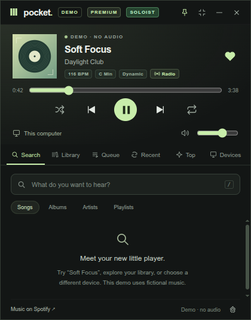

# Pocket

<p align="center">
  
</p>

<p align="center">
  <a href="https://github.com/kawaii-kitsune/pocket/actions/workflows/ci.yml"></a>
  <a href="https://github.com/kawaii-kitsune/pocket/actions/workflows/release.yml"></a>
  <a href="https://github.com/kawaii-kitsune/pocket/releases/latest"></a>
  <a href="LICENSE"></a>
  
</p>

A floating Spotify companion for Linux, Windows, and macOS. Move it by dragging its top bar, pin it above your other windows, or collapse it to a small player.

The default window is **420 × 540** logical pixels (about one ninth of a 1920 × 1080 screen). Compact mode is **420 × 200**. Resize the expanded window from 360 × 460 to 640 × 900.

## Run

Requires Node.js 22 or newer and npm.

```sh
git clone https://github.com/kawaii-kitsune/pocket.git
cd pocket
npm install
cp .env.example .env  # Optional: configure Client ID, Sentry DSN, etc.
npm start
```

To try the fictional, silent demo:

```sh
npm run demo
```

A browser preview needs **no installed dependencies**:

```sh
npm run preview
```

Open http://127.0.0.1:4173 and resize the browser to 420 × 540. The browser preview uses demo data. Desktop dragging, pinning, window resizing, and Spotify sign-in require Electron.

### Linux: sandbox helper startup error

If Electron exits with `The SUID sandbox helper binary was found, but is not configured correctly`, configure its bundled helper from the project directory:

```sh
sudo chown root:root node_modules/electron/dist/chrome-sandbox
sudo chmod 4755 node_modules/electron/dist/chrome-sandbox
npm run demo
```

Only the helper needs administrator privileges; run Pocket and npm as your normal user. These commands give the helper the ownership and setuid permissions required by Chromium's [Linux SUID sandbox](https://chromium.googlesource.com/chromium/src/+/main/docs/linux/suid_sandbox_development.md), keeping application sandboxing enabled.

## Connect Spotify

1. Create an app in the [Spotify developer dashboard](https://developer.spotify.com/dashboard), selecting Web API.
2. Register this exact redirect URI: `http://127.0.0.1:43827/callback`.
3. Copy the **Client ID** into Pocket's Settings or into `.env` as `SPOTIFY_CLIENT_ID`. No client secret is needed.
4. Complete sign-in in your default browser.
5. Open Spotify on your computer, phone, or speaker and play a song. Choose it in Pocket's **Devices** tab. Transfer selects a device; press Play to resume there.

The developer app owner needs Premium, and Spotify's playback-control API requires Premium. New development-mode apps support up to 25 allowlisted users; add other testers under your app's user management. Public distribution to arbitrary accounts requires Spotify's approval for broader access. See [current quota modes](https://developer.spotify.com/documentation/web-api/concepts/quota-modes) and [playback requirements](https://developer.spotify.com/documentation/web-api/reference/start-a-users-playback).

## Features

- **Window Controls:** Draggable, resizable, frameless window; magnetic edge snapping; always-on-top toggle; saved coordinates and dimensions.
- **Player Modes:** Full view (search, library, queue, recent, top charts, lyrics) and compact mini-player (420 × 200).
- **Playback Management:** Play/pause, previous/next, seek slider, shuffle, repeat mode, and volume slider with mute toggle.
- **Audio Analysis:** Live track BPM, key signature, and mood metrics, plus instant track-seeded Song Radio.
- **Synchronized Lyrics:** Live `.lrc` synchronized lyrics powered by LRCLIB with autoscroll.
- **Content Browsing:** Paginated search for songs, albums, artists, and playlists; personal library, top items, and queue inspection.
- **Native Desktop Integration:** System tray context menu, Windows taskbar thumbnail buttons, macOS Dock menu, and global media key shortcuts.
- **Wayland Support:** Automatic detection and Ozone configuration for modern Linux Wayland desktop environments.
- **Auto-Updates:** In-app update notifications and restart installation powered by `electron-updater` and GitHub Releases.
- **Crash Telemetry:** Cloud crash monitoring and diagnostics via `@sentry/electron` (configured via `SENTRY_DSN`).
- **Optional Local Audio Engines:**
  - Bundled `go-librespot` zero-config Spotify Connect receiver (opt-in toggle in Settings).
  - Spotify Soloist headless local player client integration over WebSocket.

## Packaging

```sh
npm run pack   # Unpacked application directory for current OS
npm run dist   # Native installers (AppImage/deb on Linux, NSIS on Windows, DMG/zip on macOS)
```

Pre-configured GitHub Actions CI/CD (`.github/workflows/release.yml`) builds and publishes releases automatically whenever a version tag (e.g. `v0.1.0`) is pushed.

## Validation

```sh
npm run check             # Syntax validation
npm test                  # 40 automated unit & integration tests
node scripts/ui-smoke.cjs # DOM interaction & Happy-DOM component smoke suite
```

All 40 unit and integration tests, JavaScript syntax checks, and DOM interaction tests pass without requiring a network connection.

## Security & Architecture

The renderer runs in an isolated, sandboxed Chromium environment with a strict Content Security Policy (`default-src 'none'`). Tokens stay exclusively in the main process and are persisted using Electron's OS-backed `safeStorage` (Linux Secret Service/KWallet, Windows DPAPI, macOS Keychain). Remote navigation is blocked, and only strictly validated IPC channels cross the bridge.

## License

[MIT](LICENSE) © 2026 Pocket contributors
